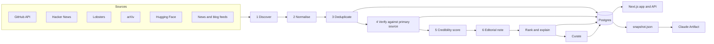

# SIGNAL / AI

A discovery engine for AI and emerging technology. It answers one question:

> What genuinely interesting things are people building, discovering, releasing or experimenting with right now?

It is not a news site. It watches GitHub, Hacker News, Lobsters, arXiv, Hugging Face, Product Hunt, engineering blogs and a handful of technology publications, collapses everything about one project into one record, verifies it against the primary source, scores it with an explainable formula, and shows the evidence next to every claim.

**Discover early. Verify carefully. Explain clearly.**

There are three ways to run it, all from this repository:

| | What it is | Data |
|---|---|---|
| **Next.js application** | The deployable product: server-rendered pages, JSON API, scheduled ingestion. | Live from Postgres, refreshed every three hours by GitHub Actions. |
| **Static site** | The same interface as one HTML page on GitHub Pages. | Rebuilt and republished by the scheduled workflow after every run, so it stays current with no machine switched on. |
| **Claude Artifact** | That same page published on claude.ai (`npm run build:artifact`). | A timestamped snapshot file. The Artifact sandbox blocks all outside network access, so it cannot update itself, and says so on the page. |

All three are built from the same React components, types and feed logic.

## Quick start

Requires Node 22.12 or newer (`.nvmrc` pins 24).

```sh
npm ci
cp .env.example .env            # every value is optional for local use
export GITHUB_TOKEN=$(gh auth token)   # optional, raises GitHub rate limits
npm run pipeline                # discover -> verify -> rank -> curate, against live sources
npm run dev                     # http://localhost:3000
```

With no `DATABASE_URL`, data lives in an embedded Postgres (PGlite) under `.data/`. The schema, migrations and SQL are identical to hosted Postgres. Stop the dev server before running pipeline commands locally: the embedded store allows one process at a time.

No network? `npm run seed:fixtures` fills an **empty** database with a small fictional dataset for interface work. Fixture records are stored with `origin = 'fixture'`, every page shows a banner saying so, and the seeder refuses to run if real records exist.

## Commands

| Command | What it does |
|---|---|
| `npm run dev` / `build` / `start` | Next.js development server, production build, production server |
| `npm run pipeline` | `discover`, `verify`, `rank`, `curate` in order |
| `npm run discover` | Stages 1 to 3: collect from every source, normalise, deduplicate, persist |
| `npm run verify` | Stages 4 to 6: enrich from the primary source, run checks, score credibility, write the editorial note |
| `npm run rank` | Recompute scores and "why this is trending" for every active record |
| `npm run curate` | Pick the featured story and build the weekly "What You Missed" edition |
| `npm run maintain` | Retention: thin old snapshots, archive dormant records, purge rejected ones |
| `npm run status` | Print pipeline status as JSON |
| `npm run db:generate` / `db:migrate` | Generate a migration from the schema / apply migrations |
| `npm run export:snapshot` | Write `public/data/snapshot.json` for the Artifact |
| `npm run build:artifact` | Build `dist/artifact/signal-ai.html` + `snapshot.json`. Add `-- --site dist/site` for the static-site version. |
| `npm run preview:artifact` | Serve the built Artifact locally the way the Artifact host does |
| `npm run lint` / `typecheck` / `test` / `test:e2e` | ESLint, `tsc`, Vitest (unit + integration), Playwright (desktop, tablet, phone) |

## Environment variables

All are server-side. None are exposed to the browser except `NEXT_PUBLIC_SITE_URL`.

| Variable | Required | Purpose |
|---|---|---|
| `DATABASE_URL` | In hosted deployments | Postgres connection string (Supabase pooler URL works). Unset: embedded PGlite in `PGLITE_DIR`. |
| `PGLITE_DIR` | No | Embedded store location. Default `.data/pglite`. |
| `GITHUB_TOKEN` | Recommended | GitHub API token. Without it: 10 searches/min and 60 core requests/hour, so far fewer repositories are enriched per run. In Actions the built-in token is used automatically. |
| `REDDIT_CLIENT_ID`, `REDDIT_CLIENT_SECRET` | No | Enables the Reddit source through its official OAuth API. Without them the source reports "skipped". |
| `AI_PROVIDER` | No | `extractive` (default, no key), `anthropic` or `openai`. |
| `ANTHROPIC_API_KEY`, `ANTHROPIC_MODEL` | With `anthropic` | Model defaults to `claude-opus-5-5`. |
| `OPENAI_API_KEY`, `OPENAI_MODEL`, `OPENAI_BASE_URL` | With `openai` | Model has no default and must be set. |
| `AI_MAX_ITEMS_PER_RUN` | No | Cost guard: most items sent to the model per run. Default 40. |
| `RANKING_WEIGHTS` | No | JSON override for ranking weights, e.g. `{"novelty":0.3}`. Renormalised to 1. |
| `VERIFY_LIMIT`, `GITHUB_CALL_BUDGET` | No | Per-run ceilings for verification and GitHub API calls. |
| `NEXT_PUBLIC_SITE_URL` | In production | Public base URL (metadata and the outbound User-Agent). |

## How it works



- **Architecture and data model:** [docs/architecture.md](docs/architecture.md)
- **Sources, access methods and limits:** [docs/sources.md](docs/sources.md)
- **Ranking and credibility formulas:** [docs/scoring.md](docs/scoring.md)
- **Design system:** [docs/design-system.md](docs/design-system.md)
- **Security:** [docs/security.md](docs/security.md)
- **Operations, schedules and deployment:** [docs/operations.md](docs/operations.md)

## Rules the code enforces

- **No invented numbers.** Star counts come from the GitHub API. Growth is the difference between snapshots this system recorded; with one snapshot the UI shows the average since creation and labels it as not a measured velocity.
- **No unsupported explanations.** "How does it work?" is filled only when the sources describe the implementation. Otherwise the page says "Not verified".
- **Model output is checked.** When an AI provider is configured, any field containing a number or URL that does not appear in the evidence is discarded and the extractive text is used instead.
- **Sources are untrusted input.** READMEs, abstracts and posts are data. Instructions inside them are ignored, flagged, and excluded from summaries.
- **Popularity is not credibility.** Stars add nothing to the confidence score. Star spikes with no matching forks or issues are flagged and discounted.
- **Publication and discovery are separate.** `published_at` is what the source says; `first_discovered_at` is when the pipeline first saw it.
- **Degraded is not failed.** A source that is down is recorded and skipped; the run continues and the UI reports reduced coverage.
- **Updates are periodic.** The UI shows the last ingestion, the last verification and the next scheduled run, and warns when data is stale. Nothing claims to be real time.

## Tests

```sh
npm test          # unit + integration (Vitest, in-memory Postgres, no network)
npm run test:e2e  # Playwright against a fixture-seeded production build and the built Artifact
```

Integration tests run the real pipeline against stubbed sources and a stubbed network; a request to any unexpected host fails the test. End-to-end tests run on desktop, tablet and phone viewports and include axe accessibility scans in light and dark themes.

## Known limitations

See [docs/operations.md](docs/operations.md#known-limitations).
